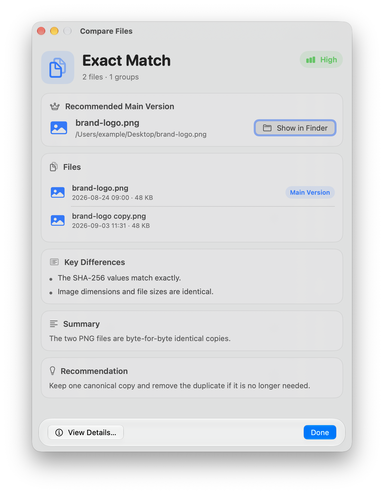
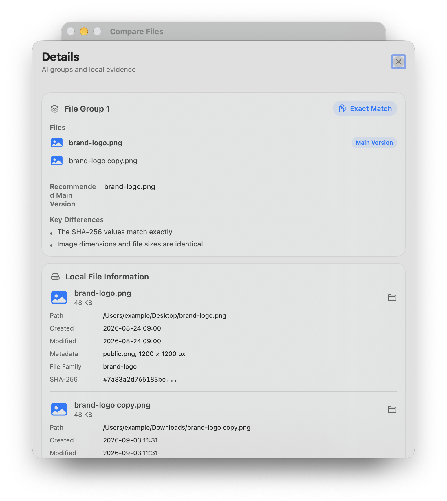

# Compare Files Viewer

[简体中文](README.zh-CN.md)

A native macOS SwiftUI viewer for file-comparison results produced by a Shortcut or another tool. It displays relationships, version order, metadata, evidence, and Finder actions; it does not compare files itself.

## Install and use

Requires macOS 26 or later, Xcode/Command Line Tools with a compatible SDK, and a configured Shortcuts **Use Model** action (ChatGPT by default).

1. Clone or download the repository and run `bash scripts/build-app.sh` from its root.
2. Create `~/Applications` and copy `.build/CompareFilesViewer.app` into it. Installation in `/Applications` is also supported; no personal username is needed.
3. Download [Compare Files.shortcut](Compare%20Files.shortcut) from the repository root and double-click to import it. If a shortcut with that name already exists, manually remove the old copy in Shortcuts before importing the update.
4. Allow running scripts in Shortcuts settings and check that the **Use Model** action has an available model/account. The `Language` Text action defaults to English; change it to Simplified Chinese if preferred.
5. Select at least two files in Finder, then choose **Quick Actions → Compare Files** from the context menu. Enable the corresponding Quick Action in System Settings if it is missing.

Byte-identical files are handled locally. Other files send the local JSON to the selected model before displaying the report. Model input includes names, paths, metadata, text excerpts, and comparison evidence; consider your selected service's data handling before use.

Read the [blog setup guide](https://jingyuan-zheng.github.io/p/compare-files-viewer/) for configuration, both key scripts, and the AI prompt. They are not duplicated in this README.

## Input and workflow

Use `CompareFilesViewer --file /path/to/result.json`, `--json '<payload>'`, or pipe the payload to stdin. The payload contains `files`, `analysis`, and optional `local_evidence`; see `ExamplePayload.json`. The included Shortcut or another producer must compare files and create this payload before launching the viewer.

## Sample inputs

The `Examples` directory contains ready-to-open payloads that exercise common viewer states:

- `versioned-report.json` — two versions of the same PDF report.
- `exact-copy.json` — two byte-identical PNG files.
- `mixed-project.json` — document versions plus a related spreadsheet.

For example:

```bash
swift run CompareFilesViewer --file Examples/mixed-project.json
```

The example paths are illustrative; the app can still display their metadata and comparison evidence, while **Reveal in Finder** only works after replacing them with paths that exist on your Mac.

## What it shows

- Overall relationship and confidence, recommended main version, and version order.
- Finder icons, paths, sizes, modification times, and Reveal in Finder actions.
- AI groups, local SHA-256 metadata, text differences, and image-comparison evidence when provided.

## Requirements and privacy

Requires macOS 26 or later and Xcode Command Line Tools to build. It performs no network request and does not upload selected files; any AI or comparison policy belongs to the producer Shortcut.

## Screenshots

Main window showing an exact-match report with Liquid Glass controls.



Details sheet showing file groups and local evidence.


