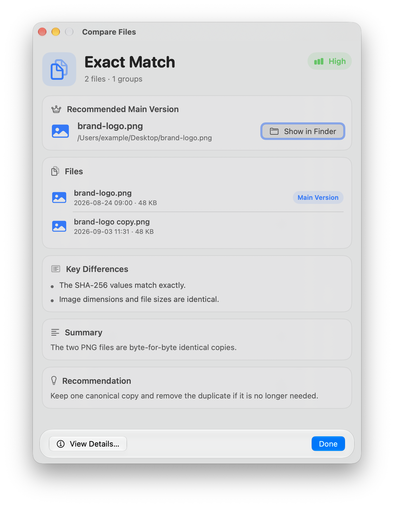
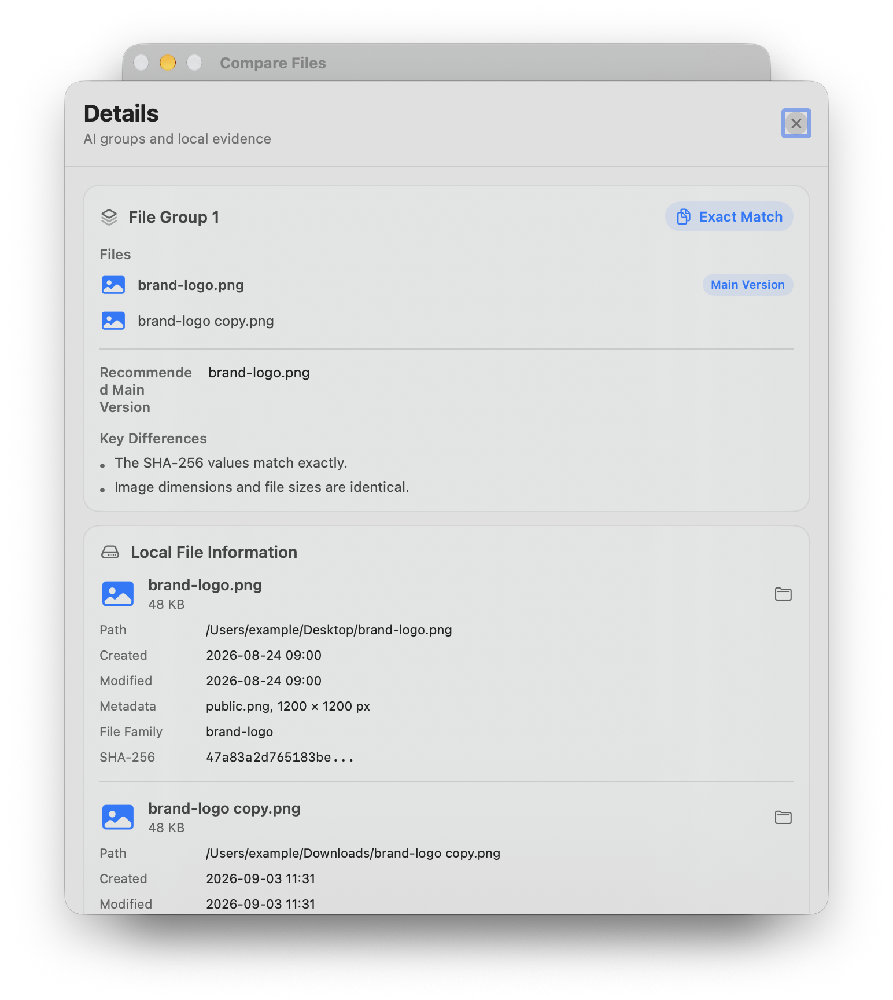

# 文件比较结果查看器

[English](README.md)

原生 macOS SwiftUI 查看器，用于展示快捷指令或其他工具生成的文件比较结果。它显示关系、版本顺序、元数据、证据和 Finder 操作；不自行比较文件。

## 安装与使用

需要 macOS 26 或更新版本、支持该 SDK 的 Xcode/Command Line Tools，以及已配置的快捷指令“使用模型”动作（默认 ChatGPT）。

1. 克隆或下载仓库，在项目根目录运行 `bash scripts/build-app.sh`。
2. 创建 `~/Applications` 文件夹，将 `.build/CompareFilesViewer.app` 复制到该目录。也支持安装到 `/Applications`，无需填写个人用户名。
3. 下载根目录的 [Compare Files.shortcut](Compare%20Files.shortcut)，双击导入“快捷指令”。同名快捷指令已存在时，请先在“快捷指令”中手动移除旧版，再导入新版。
4. 在“快捷指令”的设置中允许运行脚本，检查“使用模型”动作所选模型及账户是否可用。默认输出语言在 `Language` 文本动作中设置为 English，可改为 Simplified Chinese。
5. 在 Finder 中选中至少两个文件，右键 → 快速操作 → Compare Files；若菜单中没有显示，请在系统设置中启用对应快捷操作。

字节完全相同的文件由本地直接判断；其他文件将把本地 JSON 交给所选模型，再显示结果。模型输入含文件名、路径、元数据、文本节选和比较依据；请根据所选服务的数据处理方式决定是否使用。

完整配置、两段关键脚本及 AI prompt 见[博客使用指南](https://jingyuan-zheng.github.io/zh/p/compare-files-viewer/)。README 不重复脚本和 prompt。

## 输入与流程

可使用 `CompareFilesViewer --file /path/to/result.json`、`--json '<payload>'` 或标准输入。数据包含 `files`、`analysis` 和可选的 `local_evidence`；完整示例见 `ExamplePayload.json`。附带快捷指令或其他生产者必须先完成比较并生成数据，再启动查看器。

## 示例输入

`Examples` 目录提供可直接打开的 JSON，用于演示常见的查看器状态：

- `versioned-report.json`：同一 PDF 报告的两个版本。
- `exact-copy.json`：两个字节完全一致的 PNG 文件。
- `mixed-project.json`：文档版本加上相关但不同的电子表格。

例如：

```bash
swift run CompareFilesViewer --file Examples/mixed-project.json
```

示例中的路径只用于展示；应用仍会显示其元数据和比较证据，但“在 Finder 中显示”仅在改成 Mac 上真实存在的路径后可用。

## 显示内容

- 总体关系与置信度、推荐主版本和版本顺序。
- Finder 图标、路径、大小、修改时间及“在 Finder 中显示”。
- AI 分组、本地 SHA-256 元数据、文本差异和可选图片比较证据。

## 要求与隐私

构建需要 macOS 26 及以上和 Xcode Command Line Tools。应用不发起网络请求，也不上传文件；AI 或比较策略由生成数据的快捷指令决定。

## 界面截图

主窗口：完全相同的文件报告与 Liquid Glass 操作栏。



详情窗口：文件分组和本地比较依据。


